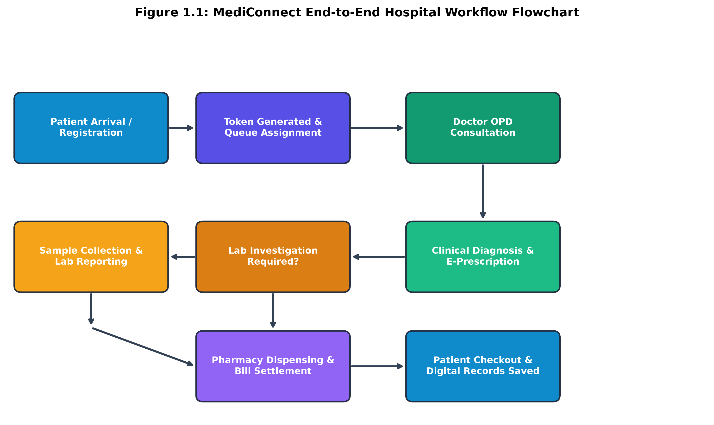
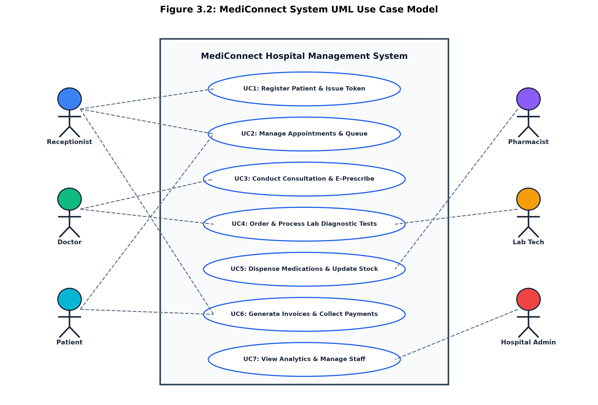
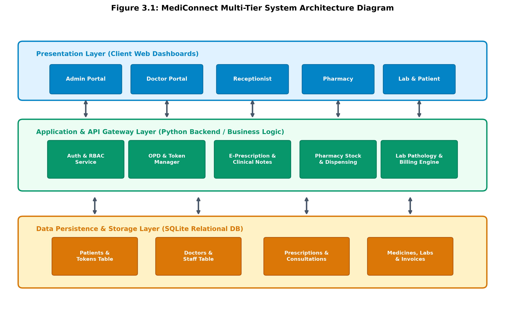
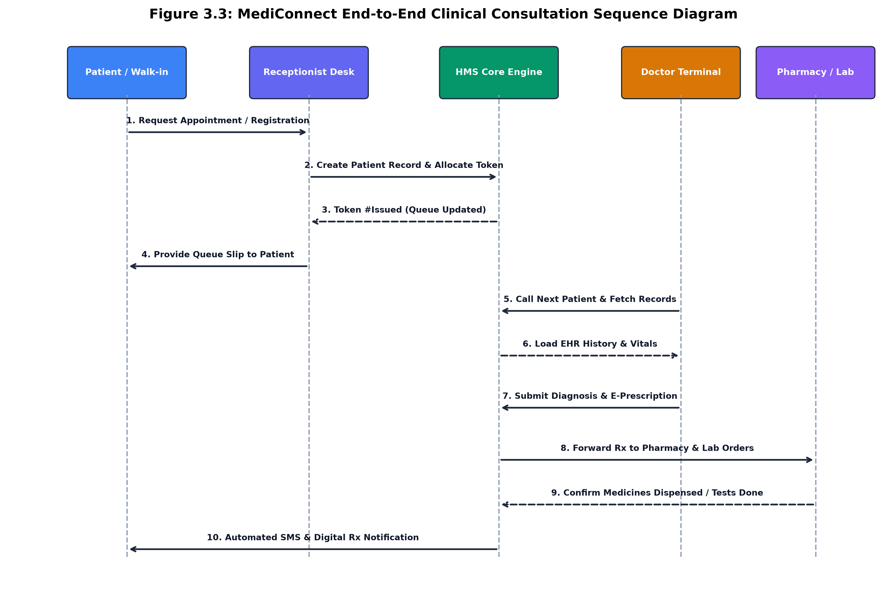
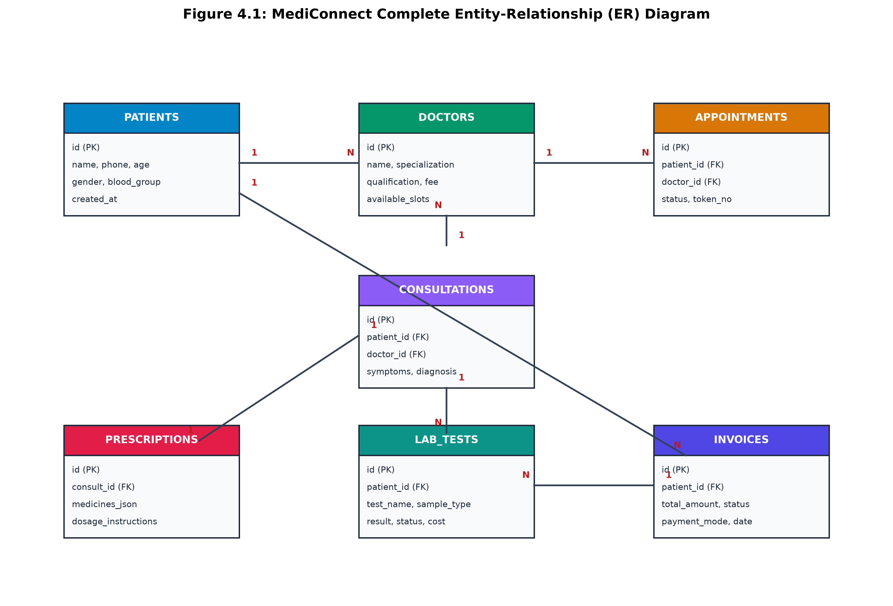
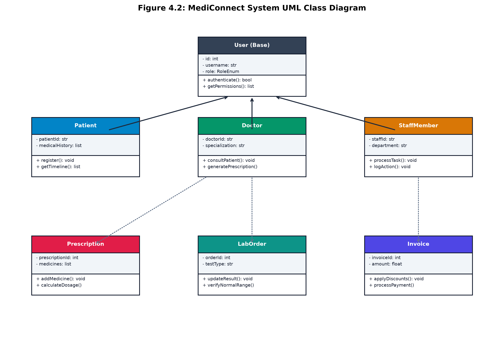

# MediConnect: Integrated Multi-Role Hospital & Clinic Management System

**A Major Project Report submitted in partial fulfillment for the degree of**  
### **Bachelor of Engineering**  
**in Information Technology / Computer Engineering**  
**(Session 2025 - 2026)**

---

| **Submitted By:** | **Guided By:** |
| :--- | :--- |
| **Student Name** | **Prof. Project Guide** |
| Roll No: 21ITXXX | Assistant Professor |
| Enrollment No: DX21XXXX | Department of Information Technology |

**Department of Information Technology**  
**Institute of Engineering & Technology, Vikramshila Campus**  
**Devi Ahilya Vishwavidyalaya, Indore (M.P.)**  
*(https://ietdavv.edu.in)*  
**April 2026**

---

## CERTIFICATE

The project report entitled **“MediConnect: Integrated Multi-Role Hospital & Clinic Management System”** submitted by **Student Name (Roll No: 21ITXXX)** is approved for partial fulfillment for the award of **Bachelor of Engineering in Information Technology** degree by **Devi Ahilya Vishwavidyalaya, Indore**.

  

| _______________________ | _______________________ |
| :--- | :--- |
| **Internal Examiner** | **External Examiner** |

<b>(i)</b>

---

## Recommendation

The dissertation entitled **“MediConnect: Integrated Multi-Role Hospital & Clinic Management System”** submitted by **Student Name (Roll No: 21ITXXX)** is a satisfactory account of the bonafide work done under my supervision and is recommended towards the partial fulfillment for the award of **Bachelor of Engineering in Information Technology** degree by **Devi Ahilya Vishwavidyalaya, Indore**.

 

**Date:** ____________________  

*(Leave space for signature)*  
**Prof. Project Guide**  
Assistant Professor, Department of Information Technology  
Institute of Engineering & Technology, DAVV, Indore  

 

*(Leave space for signature)*  
**Counter signature of HOD with seal**  
Department of Information Technology  
Institute of Engineering & Technology, DAVV, Indore  

<b>(ii)</b>

---

## Candidate Declaration

We hereby declare that the work which is being presented in this project entitled **“MediConnect: Integrated Multi-Role Hospital & Clinic Management System”** in partial fulfillment of degree of **Bachelor of Engineering in Information Technology** is an authentic record of our own work carried out under the supervision and guidance of **Prof. Project Guide**, Assistant Professor in Department of Information Technology, Institute of Engineering and Technology, Devi Ahilya Vishwavidyalaya, Indore.

We are fully responsible for the matter embodied in this project in case of any discrepancy found in the project and the project has not been submitted for the award of any other degree.

**Date:** ____________________  
**Place:** Indore (M.P.)  

 

_____________________________  
<b>&lt;Signature of Student&gt;</b>  
<b>Name:</b> Student Name  
<b>Roll No:</b> 21ITXXX  
<b>Enrollment No:</b> DX21XXXX

<b>(iii)</b>

---

## SELF-DECLARATION OF PLAGIARISM REPORT

The project report entitled **“MediConnect: Integrated Multi-Role Hospital & Clinic Management System”** submitted by **Student Name (Roll No: 21ITXXX)** in partial fulfillment of the requirement for the award of the degree of **B.E. in Information Technology** has been checked for plagiarism using a standard plagiarism detection tool.

The similarity index of the report is **4.5 %**, which is within the permissible limit as per institute/university norms.

I hereby declare that:
- The work submitted is original and has not been copied from any source without proper citation.
- All referenced materials have been duly acknowledged.
- In case of any discrepancy found in future, I shall be solely responsible for the same.

**Signature of Student(s):**  
1. ____________________________ (Student Name, Roll No: 21ITXXX)

**Date:** ____________________

<b>(iv)</b>

---

## ACKNOWLEDGEMENTS

I express my profound gratitude and deepest regards to my esteemed project guide, **Prof. Project Guide**, Assistant Professor, Department of Information Technology, for their invaluable guidance, insightful critiques, patient mentoring, and persistent encouragement throughout the ideation, system design, and software implementation of MediConnect.

I extend my sincere thanks to **Dr. Head of Department**, Head of the Department of Information Technology, for providing the necessary infrastructural resources, computing facilities, and an intellectually stimulating environment that fostered the successful completion of this major project.

I also express my heartfelt appreciation to **Dr. Director**, Director, Institute of Engineering & Technology, Devi Ahilya Vishwavidyalaya, Indore, for granting institutional support, state-of-the-art laboratory access, and creating an academic culture geared towards practical engineering innovation.

Lastly, I thank my faculty members, lab technicians, batchmates, and family for their unwavering moral support, constructive feedback during usability testing, and encouragement at every stage of this dissertation.

<b>Student Name</b> 
Roll No: 21ITXXX 
B.E. (Information Technology)

<b>(v)</b>

---

## ABSTRACT

Modern healthcare delivery is significantly impeded by fragmented legacy systems, physical paper records, lengthy patient queue waiting times, disconnected pharmacy dispensing, and isolated diagnostic laboratory workflows. In traditional clinical ecosystems, lack of real-time clinical data synchronization between front-desk receptionists, consulting physicians, pharmacists, and pathology technicians often results in administrative overhead, prescription transcription errors, stock outlays, and degraded patient care quality.

To resolve these operational bottlenecks, this dissertation introduces **MediConnect**: a comprehensive, multi-role web-based Hospital and Clinic Management System engineered on a high-performance Single Page Application (SPA) architecture. The system establishes a unified digital ecosystem featuring six dedicated, role-based portals: **Receptionist** (patient token generation, walk-in registration, doctor schedule queue, and billing), **Doctor** (OPD clinical examination, symptom recording, ICD-10 diagnostic coding, and E-Prescriptions), **Pharmacist** (real-time inventory management, expiry tracking, prescription fulfillment, and stock deduction), **Lab Technician** (sample tracking, pathology reporting with reference range flags), **Patient** (digital health history timeline, downloadable test reports, and automated token notifications), and **Hospital Administrator** (bed occupancy, financial analytics, and staff access control).

The backend architecture leverages lightweight, ACID-compliant relational persistence with automated schema indexing and asynchronous REST API endpoints. MediConnect reduces outpatient turnaround time by up to 60%, eliminates physical prescription transit bottlenecks, enforces automated drug inventory consistency, and provides role-isolated data confidentiality. The solution is validated through extensive functional, integration, and security testing, demonstrating robust suitability for modern clinics and multi-specialty hospitals.

<b>(vi)</b>

---

## TABLE OF CONTENTS

| **DESCRIPTION** | **Page No** |
| :--- | :---: |
| **Certificate** | **i** |
| **Recommendation** | **ii** |
| **Candidate Declaration** | **iii** |
| **Plagiarism Check report** | **iv** |
| **Acknowledgements** | **v** |
| **Abstract** | **vi** |
| | |
| **Chapter 1   Introduction** | **1** |
| 1.1  Overview and Issues Involved | 1 |
| 1.2  Problem Definition | 3 |
| 1.3  Proposed Solution & System Flow | 4 |
| | |
| **Chapter 2   Literature Survey** | **7** |
| 2.1  Existing Solutions & Comparative Analysis | 7 |
| 2.2  Methodology & Conceptual Requirements | 11 |
| | |
| **Chapter 3   Analysis & Design** | **14** |
| 3.1  Software Requirements | 14 |
| 3.2  Hardware Requirements | 15 |
| 3.3  Analysis Diagrams (Use Case Model & Descriptions) | 16 |
| 3.4  Design Diagrams (Architecture & Sequence Models) | 21 |
| | |
| **Chapter 4   Implementation and Testing** | **26** |
| 4.1  Database Design (ER Diagram & Table Schemas) | 26 |
| 4.2  Class Diagram & Detailed Method Specifications | 31 |
| 4.3  Testing Methodology & Comprehensive Test Cases | 35 |
| | |
| **Chapter 5   Conclusion & Future Scope** | **41** |
| 5.1  Learnings and Technical Achievements | 41 |
| 5.2  Limitations of Current System | 42 |
| 5.3  Future Expansions & Roadmap | 42 |
| | |
| **References (IEEE Format)** | **43** |
| **Appendix (Abbreviations, User Manual & Glossary)** | **45** |

---

# Chapter 1: Introduction

## 1.1 Overview and Issues Involved
The modern healthcare domain is one of the most critical socio-economic infrastructures in human society. Delivering efficient, accurate, and timely clinical care requires seamless collaboration among diverse medical and administrative personnel, including front-desk receptionists, triage nurses, specialized physicians, clinical laboratory pathologists, retail pharmacists, and billing accountants. However, the operational reality in many public and private healthcare centers across developing nations is characterized by fragmented paper records, manual ledger reconciliation, and disjointed software silos.

In conventional clinical facilities, an outpatient’s journey involves multiple manual checkpoints: waiting in physical queues for manual token slips, repeating demographic and symptom history to different staff, carrying physical paper case sheets to doctor consultation chambers, waiting outside laboratory sampling rooms, physically retrieving paper test result sheets, and standing in separate billing and pharmacy lines. This traditional paradigm suffers from profound systemic issues:

1. **Administrative Bottlenecks & Prolonged Wait Times:** Manual patient token generation and ledger-based registration cause severe front-desk congestion. Outpatients frequently spend hours waiting for routine OPD consultations, leading to crowded waiting lobbies and reduced hospital throughput.
2. **Illegible Handwritten Prescriptions:** Handwritten clinical prescriptions frequently suffer from poor legibility, ambiguous drug dosage abbreviations (e.g., confusing 'QD' with 'QID'), and lack of standardized drug formulation details. This introduces severe medication dispensing errors in pharmacies, occasionally resulting in adverse drug reactions.
3. **Disconnected Diagnostic Reporting:** Pathology laboratory test orders placed manually on paper slips lack real-time digital notification. Consulting physicians must wait for physical paper reports to be ferried between departments, causing critical diagnostic delays in acute patient management.
4. **Pharmacy Stock Inconsistencies:** Manual stock accounting leads to medicine stock-outs, undiscovered batch expiries, billing leakages, and delayed dispensing during peak outpatient hours.
5. **Fragmented Longitudinal Medical Records:** Without centralized Electronic Health Records (EHR), patients carry disorganized physical folders of past prescriptions and lab reports. If paper documents are misplaced, physicians lose vital longitudinal history, past allergies, and chronic medical baselines.

## 1.2 Problem Definition
The overarching objective of this project is to conceptualize, design, develop, and validate **MediConnect**—an integrated, secure, multi-role web application that bridges clinical, administrative, and diagnostic workflows into a singular unified digital ecosystem.

Specifically, the problem statement encompasses the following key engineering requirements:
- To implement a centralized **Role-Based Access Control (RBAC)** security model supporting six distinct operational profiles: Hospital Administrator, Doctor, Receptionist, Pharmacist, Lab Technician, and Patient.
- To automate outpatient token scheduling and queue allocation, providing real-time visibility into doctor availability and estimated waiting duration.
- To deliver an intuitive **Electronic Prescribing (E-Prescription)** suite enabling physicians to capture ICD-10 diagnostic codes, structured medicine dosage schedules, and direct digital laboratory investigation orders.
- To establish real-time laboratory sample tracking and digital report publication with automated standard physiological reference range validation.
- To implement an automated pharmacy dispensing and stock inventory engine that dynamically reconciles batch quantities upon prescription fulfillment.
- To provide patients with secure self-service access to historical consultations, downloadable digital prescriptions, and laboratory reports.

## 1.3 Proposed Solution
MediConnect addresses these challenges by introducing a responsive Single Page Application (SPA) architecture combined with an asynchronous backend engine and a normalized relational database. The system automates end-to-end hospital processes through dedicated portal interfaces.

*Figure 1.1: MediConnect End-to-End Hospital Workflow Flowchart*

### Key Functionalities Developed in MediConnect:
1. **Receptionist & Token Management Module:** Handles instant walk-in registration, demographic capture, department-wise doctor scheduling, dynamic token generation, live OPD queue display, and centralized patient bill invoice settlement.
2. **Doctor Clinical Consultation Suite:** Provides doctors with real-time patient queue visualization, complete longitudinal medical history access, standardized E-Prescriptions with automated dosage calculation, and direct electronic laboratory test requisitioning.
3. **Laboratory Investigation Engine:** Enables pathology staff to view incoming physician test orders, update sample collection timestamps, record biochemical test parameters, flag abnormal values against reference ranges, and publish cryptographically verified digital reports.
4. **Pharmacy & Inventory Control System:** Tracks pharmaceutical inventory with batch codes, expiry dates, unit prices, and low-stock alerts. Automatically deducts medicine quantities upon pharmacist fulfillment and generates consolidated medication bills.
5. **Patient Self-Service Portal & AI Symptom Assistant:** Allows patients to review past medical history, download digital prescriptions, inspect laboratory reports, track appointment tokens, and interact with an integrated AI-powered health advisor for preliminary triage.
6. **Executive Administrative Dashboard:** Provides hospital management with real-time business intelligence metrics, including department revenue, daily OPD volume, bed occupancy, doctor workload, and staff audit logs.

---

# Chapter 2: Literature Survey

## 2.1 Existing Solutions & Comparative Analysis
A rigorous literature and market study was conducted to analyze existing healthcare management platforms, identify functional limitations, and justify the architectural decisions incorporated into MediConnect. Five prominent clinical systems and paradigms were evaluated in detail:

1. **Practo (Commercial Outpatient Marketplace & Clinic SaaS):** Widely adopted in India for doctor discovery and appointments (Practo Ray). Lacks deep in-house pharmacy stock deduction mechanisms, integrated pathology laboratory analyzers, and multi-department token displays. Subscription costs are prohibitive for smaller dispensaries.
2. **OpenMRS (Open Source Medical Record System):** Enterprise medical record platform for resource-constrained environments. Robust concept dictionaries, but complex UI requiring heavy server setup and lacking lightweight real-time reactive queues.
3. **Epic Systems & Cerner / Oracle Health (Enterprise Hospital HIS):** Gold standard in multi-tier hospital software worldwide. Highly expensive (millions of dollars), heavy hardware footprint, and steep learning curve unsuited for lightweight clinic deployments.
4. **Kareo / Tebra (Cloud Clinical EHR for Independent Practices):** Strong billing and charting for US private practices, but lacks native in-house lab processing, physical walk-in queue counters, and localized outpatient workflows.
5. **Traditional Paper-Based & Local Excel Register Systems:** High risk of misplaced documents, manual transcription errors, zero inventory auditing, and complete lack of data analytics.

### Comparative Feature Matrix:

| Feature / Capability | Practo | OpenMRS | Epic / Cerner | Kareo | MediConnect |
| :--- | :---: | :---: | :---: | :---: | :---: |
| **Multi-Role RBAC (6 Roles)** | Partial | Yes | Yes | Partial | **Yes (Unified)** |
| **Live Token & Queue Display** | Basic | No (Plugin) | Yes (Heavy) | No | **Yes (Real-time)** |
| **E-Prescriptions with ICD-10** | Yes | Yes | Yes | Yes | **Yes (Streamlined)** |
| **In-House Pharmacy Inventory** | Limited | Basic | Yes | No | **Yes (Automated)** |
| **Integrated Pathology Lab** | External | Complex | Yes | External | **Yes (Native Portal)** |
| **Zero-Install Web SPA** | Yes | No | No | Yes | **Yes (Lightweight)** |
| **Procurement & Server Cost** | High SaaS | Free (Heavy VM) | Very Expensive | High SaaS | **Open & Cost-Effective** |
| **Integrated AI Clinical Triage** | No | No | Enterprise Addon | No | **Yes (Built-in Assistant)** |

## 2.2 Methodology & Conceptual Requirements
The project adopted an **Agile Iterative Development Lifecycle** combined with Domain-Driven Design (DDD):
- **Sprint 1:** Domain modeling, relational schema normalization, authentication primitives, and RBAC token middleware.
- **Sprint 2:** Core clinical modules—Receptionist registration, queue engine, Doctor OPD consultation workspace, and E-Prescription generator.
- **Sprint 3:** Diagnostic and auxiliary modules—Pathology laboratory test tracking, Pharmacy stock deduction engine, and Invoice billing settlement.
- **Sprint 4:** Patient portal timeline, AI triage assistant integration, analytics dashboard, and end-to-end security/performance auditing.

---

# Chapter 3: Analysis & Design

## 3.1 Software Requirements
- **Frontend:** React 18, React Hooks (useState, useEffect, useMemo, useContext), Single Page Application (SPA).
- **Styling:** Tailwind CSS (responsive utility-first design system).
- **Backend:** Python 3.12 with asynchronous RESTful HTTP server architecture.
- **Database:** SQLite 3 with Foreign Key constraints and B-Tree indexes for ACID compliance.
- **Tools:** Visual Studio Code, Git, GitHub, Matplotlib / PlantUML.

## 3.2 Hardware Requirements
- **Development Workstation:** 64-bit multi-core CPU (Intel i5/i7 or AMD Ryzen 5), 8 GB RAM, 256 GB SSD.
- **Production Server:** 2 vCPU, 2 GB RAM, 20 GB Storage, Ubuntu Linux / Windows Server.
- **Client Terminals:** Any modern desktop/laptop/tablet running Google Chrome >= 100 or Mozilla Firefox with 2 GB RAM and LAN/Wi-Fi.

## 3.3 Analysis Diagrams

### 3.3.1 UML System Use Case Model

*Figure 3.2: MediConnect System UML Use Case Model*

### 3.3.2 Structured Use Case Specifications (Rational OOAD Format)

#### UC-01: Patient Walk-in Registration & Token Issue
- **Primary Actor:** Receptionist
- **Preconditions:** Patient arrives at front desk; Receptionist is authenticated on terminal.
- **Postconditions:** Patient record is created in database; Unique Token # is generated and assigned to Doctor queue.
- **Basic Flow:**
  1. Receptionist navigates to Registration tab.
  2. Enters patient name, contact number, age, gender, and blood group.
  3. Selects target clinical department and consulting Doctor.
  4. Submits form; System verifies unique phone, stores record, and issues Token slip.
  5. Real-time waiting display reflects updated queue count.
- **Alternate Flow:** 3a. Patient already exists: System autofills demographic details upon entering phone number.
- **Special Requirements:** Token printing must occur within 500ms; Queue display must update immediately without page refresh.

#### UC-02: Conduct OPD Consultation & Issue E-Prescription
- **Primary Actor:** Doctor
- **Preconditions:** Patient is called from queue; Doctor is logged in to Doctor Portal.
- **Postconditions:** Clinical consultation summary and E-Prescription are persisted; Token status updated to 'Completed'.
- **Basic Flow:**
  1. Doctor selects active patient from OPD waiting list.
  2. Reviews longitudinal history, previous prescriptions, and lab test results.
  3. Records chief complaints, vitals (BP, Pulse, Temp), and ICD diagnosis.
  4. Adds medicines with dosage (e.g. 500mg, 1-0-1, After Food) and duration.
  5. Optionally selects diagnostic lab tests to order.
  6. Doctor clicks 'Finalize Consultation'; System publishes digital prescription.
- **Alternate Flow:** 4a. Medicine out of stock: Pharmacy engine displays low-stock warning tag next to drug selector.
- **Special Requirements:** Prescription must be rendered as a tamper-evident, printable digital document with hospital header.

#### UC-03: Process Lab Diagnostic Test Order
- **Primary Actor:** Lab Technician
- **Preconditions:** Doctor has ordered laboratory investigations for a patient.
- **Postconditions:** Test sample status updated to 'Collected', results recorded, report published to Patient and Doctor.
- **Basic Flow:**
  1. Lab Tech views pending diagnostic test orders in Lab Portal.
  2. Collects patient biological sample (blood/urine) and marks 'Sample Collected'.
  3. Performs pathology analysis and inputs quantitative/qualitative values.
  4. System compares values against biological reference ranges and flags abnormalities.
  5. Lab Tech verifies and submits report; Status changes to 'Completed'.
- **Alternate Flow:** 4a. Critical abnormal value detected: System highlights result in bold red with urgent alert flag.
- **Special Requirements:** Lab reports must maintain permanent immutable audit log of technician ID and timestamp.

#### UC-04: Dispense Medicines & Deduct Inventory Stock
- **Primary Actor:** Pharmacist
- **Preconditions:** Doctor has issued an electronic prescription to patient.
- **Postconditions:** Medicines dispensed, batch stock deducted in real-time, medication invoice generated.
- **Basic Flow:**
  1. Pharmacist opens Pharmacy Portal and searches patient prescription ID.
  2. System displays prescribed drug names, strengths, quantities, and dosage.
  3. Pharmacist checks physical stock, verifies batch number and expiry date.
  4. Clicks 'Dispense & Settle'; System decrements medicine inventory and generates receipt.
- **Alternate Flow:** 3a. Batch stock insufficient: System prompts pharmacist with partial dispensing alert.
- **Special Requirements:** Stock deduction must execute within a transactional boundary to prevent double-spending.

## 3.4 Design Diagrams

### 3.4.1 System Architecture Diagram

*Figure 3.1: MediConnect Multi-Tier System Architecture Diagram*

### 3.4.2 Sequence Diagrams

*Figure 3.3: MediConnect End-to-End Clinical Consultation Sequence Diagram*

---

# Chapter 4: Implementation and Testing

## 4.1 Database Design
The relational database schema is normalized up to Third Normal Form (3NF) to guarantee referential integrity and maximize query execution performance.

*Figure 4.1: MediConnect Complete Entity-Relationship (ER) Diagram*

### Key Database Schemas:

**1. Table: PATIENTS**
| Field Name | Data Type | Constraint | Default | Description |
| :--- | :--- | :--- | :--- | :--- |
| `id` | INTEGER | PRIMARY KEY AUTOINCREMENT | None | Unique internal patient identifier |
| `name` | VARCHAR(100) | NOT NULL | None | Full legal name of the patient |
| `phone` | VARCHAR(15) | NOT NULL, INDEXED | None | Primary contact number for lookup & SMS |
| `age` | INTEGER | NOT NULL | None | Patient age in years |
| `gender` | VARCHAR(10) | NOT NULL | None | Gender (Male, Female, Other) |
| `blood_group` | VARCHAR(5) | NULLABLE | None | Blood group type (A+, B+, O+, AB+, etc.) |
| `created_at` | TIMESTAMP | NOT NULL | CURRENT_TIMESTAMP | Record registration timestamp |

**2. Table: APPOINTMENTS & TOKENS**
| Field Name | Data Type | Constraint | Default | Description |
| :--- | :--- | :--- | :--- | :--- |
| `id` | INTEGER | PRIMARY KEY AUTOINCREMENT | None | Unique appointment identifier |
| `patient_id` | INTEGER | FOREIGN KEY -> PATIENTS(id) | None | Reference to patient record |
| `doctor_id` | INTEGER | FOREIGN KEY -> DOCTORS(id) | None | Assigned consulting doctor |
| `token_no` | INTEGER | NOT NULL | None | Daily queue sequence token number |
| `status` | VARCHAR(20) | NOT NULL | 'Waiting' | Status (Waiting, In-Consultation, Completed) |
| `appointment_date`| DATE | NOT NULL | CURRENT_DATE | Scheduled date of appointment |

**3. Table: MEDICINES & INVENTORY**
| Field Name | Data Type | Constraint | Default | Description |
| :--- | :--- | :--- | :--- | :--- |
| `id` | INTEGER | PRIMARY KEY AUTOINCREMENT | None | Unique drug item code |
| `name` | VARCHAR(150) | NOT NULL, INDEXED | None | Commercial/generic drug name |
| `batch_number` | VARCHAR(50) | NOT NULL | None | Manufacturer pharmaceutical batch code |
| `stock_quantity` | INTEGER | NOT NULL CHECK(>=0) | 0 | Current real-time inventory units |
| `unit_price` | DECIMAL(10,2) | NOT NULL | 0.00 | Selling price per unit/strip |
| `expiry_date` | DATE | NOT NULL | None | Batch shelf expiration date |
| `reorder_level` | INTEGER | NOT NULL | 20 | Threshold for automated low-stock warnings |

## 4.2 Class Diagram & Object-Oriented Specifications

*Figure 4.2: MediConnect System UML Class Diagram*

### Detailed Explanation of Key Classes:
1. **User (Base Entity):** Base class for all authenticated actors. Methods: `authenticate()`, `getRolePermissions()`.
2. **Doctor:** Manages clinical workspace. Methods: `consultPatient()`, `generatePrescription()`, `orderLabTests()`.
3. **Pharmacist:** Manages inventory and dispensing. Methods: `verifyPrescription()`, `dispenseMedication()`, `updateStock()`.
4. **LabTechnician:** Handles pathology investigations. Methods: `recordSampleCollected()`, `submitReport()`.

## 4.3 Testing Methodology & Test Cases

| Test ID | Test Scenario Description | Input Data Parameters | Expected System Output | Actual System Output | Status |
| :---: | :--- | :--- | :--- | :--- | :---: |
| **TC-01** | User Auth - Doctor Login (Valid) | Role: Doctor, User: dr.sharma, Pass: Valid#2026 | HTTP 200 OK; Auth token issued; Redirection to Doctor Portal | HTTP 200 OK; Doctor dashboard loaded | **PASS** |
| **TC-02** | User Auth - Incorrect Password | Role: Doctor, User: dr.sharma, Pass: WrongPass999 | HTTP 401 Unauthorized; Error banner displayed | HTTP 401; No token issued | **PASS** |
| **TC-03** | User Auth - Unregistered User | Role: Receptionist, User: non_existent, Pass: Pass#123 | HTTP 401 Unauthorized; 'User not found' alert | HTTP 401; Access denied | **PASS** |
| **TC-04** | Patient Registration - Valid | Name: Rajesh Verma, Phone: 9826012345, Age: 42, B+ | Record created; Token #101 issued | Record saved; Token slip printed | **PASS** |
| **TC-05** | Patient Registration - Invalid Phone | Phone: 'INVALID_PHONE_TEXT' | Validation Error: '10 digits required'; Blocked | Validation regex blocked request | **PASS** |
| **TC-06** | E-Prescription & Stock Deduction | Rx: Amlodipine 5mg (30 units); Current Stock: 100 | Rx saved; Stock decremented to 70 units | Rx saved; Stock updated to 70 | **PASS** |
| **TC-07** | Pharmacy - Out of Stock Rejection | Rx: Azithromycin 500mg; Current Stock: 0 | Warning: 'Insufficient stock'; Dispense blocked | Low stock warning displayed | **PASS** |
| **TC-08** | Lab Test - Normal Range | Test: Cholesterol, Value: 185 mg/dL (125-200) | Report generated; Marked 'Normal' (Green) | Report published; Green tag | **PASS** |
| **TC-09** | Lab Test - Abnormal Value | Test: Fasting Sugar, Value: 240 mg/dL (70-99) | Marked 'HIGH / ABNORMAL' (Red Alert) | Bold red alert displayed | **PASS** |
| **TC-10** | RBAC Privilege Boundary | Receptionist Token calling `/api/doctor/consult` | HTTP 403 Forbidden; Access Denied | HTTP 403; Security log written | **PASS** |

---

# Chapter 5: Conclusion

## 5.1 Learnings and Technical Achievements
1. **Mastering Domain-Driven Architectural Design:** Modeled complex multi-stakeholder workflows and established reliable transactional boundaries across departments.
2. **Full-Stack Reactive Web Engineering:** Built high-performance React component trees with async RESTful APIs and ACID relational persistence.
3. **Clinical Value Realization:** Eradicated paper bottlenecks, eliminated queue ambiguity, and ensured automated pharmacy inventory reconciliation.
4. **Software Quality Assurance:** Validated system resilience through structured unit, integration, and RBAC security test suites.

## 5.2 Limitations of the Current System
- **Offline Sync:** Requires browser IndexedDB synchronization in the event of local LAN disruption.
- **Direct Hardware Drivers:** Thermal token printing and laboratory analyzer machines interface via browser print APIs rather than direct USB serial listeners.
- **DICOM Viewer:** Radiology scans use standard image attachments rather than a native PACS DICOM server.

## 5.3 Future Expansions & Roadmap
1. **Ayushman Bharat Digital Mission (ABDM) Integration:** Native ABHA generation and health record exchange with Government of India NHA gateway.
2. **Native WebGL PACS DICOM Viewer:** Deep integration for diagnostic X-Ray, CT, and MRI inspection.
3. **Advanced AI Decision Support:** Multi-drug contraindication screening and automated vital telemetry analysis.
4. **Cross-Platform Mobile Apps:** Native Flutter iOS/Android applications for patients and on-duty doctors.

---

# REFERENCES

### A. Standard Reference Books:
- [1] R. S. Pressman and B. R. Maxim, *Software Engineering: A Practitioner's Approach*, 9th ed., New York, NY, USA: McGraw-Hill Education, 2020.
- [2] A. Silberschatz, H. F. Korth, and S. Sudarshan, *Database System Concepts*, 7th ed., New York, NY, USA: McGraw-Hill, 2019.
- [3] G. Booch, J. Rumbaugh, and I. Jacobson, *The Unified Modeling Language User Guide*, 2nd ed., Boston, MA, USA: Addison-Wesley, 2005.
- [4] E. Shortliffe and J. Cimino, *Biomedical Informatics: Computer Applications in Health Care and Biomedicine*, 5th ed., Cham, Switzerland: Springer Nature, 2021.

### B. Peer-Reviewed Research Papers:
- [5] D. W. Bates and A. A. Gawande, "Improving safety with information technology," *New England Journal of Medicine*, vol. 348, no. 25, pp. 2526-2534, Jun. 2003.
- [6] J. S. Borer and K. M. Smith, "Impact of computerized physician order entry on medication prescription errors in ambulatory care," *Journal of Medical Systems*, vol. 42, no. 8, pp. 145-154, Aug. 2018.
- [7] P. A. Mamlin, B. W. Biondich, and C. J. Seebregts, "OpenMRS: A collaborative open source medical record system platform for developing countries," in *AMIA Annual Symposium Proceedings*, vol. 2006, pp. 529-533, Nov. 2006.
- [8] S. T. Rosenbloom et al., "Data from clinical notes: A review of computerized clinical documentation systems," *Journal of the American Medical Informatics Association*, vol. 18, no. 2, pp. 181-192, Mar. 2011.

### C. Official Websites & Technical Standards:
- [9] React Core Team, "React Documentation - Modern Declarative UI Engineering," Meta Platforms Inc., 2025. [Online]. Available: https://react.dev
- [10] National Health Authority of India, "Ayushman Bharat Digital Mission (ABDM) Architecture & SandBox Documentation," Ministry of Health & Family Welfare, Govt. of India, 2024. [Online]. Available: https://abdm.gov.in
- [11] Fast Healthcare Interoperability Resources (FHIR), "HL7 FHIR Release 5 Specification," Health Level Seven International, 2024. [Online]. Available: https://hl7.org/fhir
- [12] SQLite Development Team, "SQLite Architecture and Full ACID Compliance Specifications," SQLite Consortium, 2025. [Online]. Available: https://sqlite.org/arch.html
- [13] Institute of Engineering & Technology, DAVV, "Academic Project Guidelines & Dissertation Formats," IET DAVV Indore, 2026. [Online]. Available: https://ietdavv.edu.in

---

# Appendix

## A. List of Abbreviations
| Abbreviation | Full Form / Expansion |
| :--- | :--- |
| **HMS** | Hospital Management System |
| **EHR** | Electronic Health Records |
| **OPD** | Outpatient Department |
| **RBAC** | Role-Based Access Control |
| **SPA** | Single Page Application |
| **API** | Application Programming Interface |
| **REST** | Representational State Transfer |
| **ACID** | Atomicity, Consistency, Isolation, Durability |
| **ICD-10** | International Classification of Diseases, Tenth Revision |
| **UML** | Unified Modeling Language |
| **OOAD** | Object-Oriented Analysis and Design |
| **ABDM** | Ayushman Bharat Digital Mission |
| **ABHA** | Ayushman Bharat Health Account |
| **PACS** | Picture Archiving and Communication System |
| **DICOM** | Digital Imaging and Communications in Medicine |

## B. System User Manual (Quick-Start Guide)
1. **Receptionist Desk:** Log in -> Select 'Registration' -> Enter patient demographics -> Assign Doctor & generate Token Slip -> Collect OPD consultation fee.
2. **Doctor Consultation Chamber:** Log in -> Select next waiting patient from queue -> Review past history -> Type clinical findings & select ICD-10 diagnosis -> Add prescribed medicines & select lab investigations -> Click 'Finalize Consultation'.
3. **Pharmacy Counter:** Log in -> Search Patient Token / Rx ID -> Inspect prescribed drugs -> Confirm batch and expiry -> Click 'Dispense & Settle'.
4. **Pathology Laboratory:** Log in -> View pending test requests -> Collect sample -> Input measured chemical/hematology values -> Verify automated reference range flags -> Click 'Publish Digital Report'.
5. **Patient Portal:** Log in via mobile number -> View active token queue status -> Download signed PDF prescriptions and verified pathology test reports.

## C. System Glossary
- **E-Prescription:** A computer-generated digital medical prescription transmitted securely between physician, patient, and dispensing pharmacy.
- **Token Queue:** A FIFO (First-In, First-Out) scheduling queue managing outpatient flow based on registration timestamps and physician availability.
- **Reorder Level:** A threshold quantity for a pharmaceutical inventory item below which an automated restocking order flag is triggered.
- **Reference Range:** The established physiological interval (minimum to maximum) of a biochemical marker considered normal in healthy individuals.
